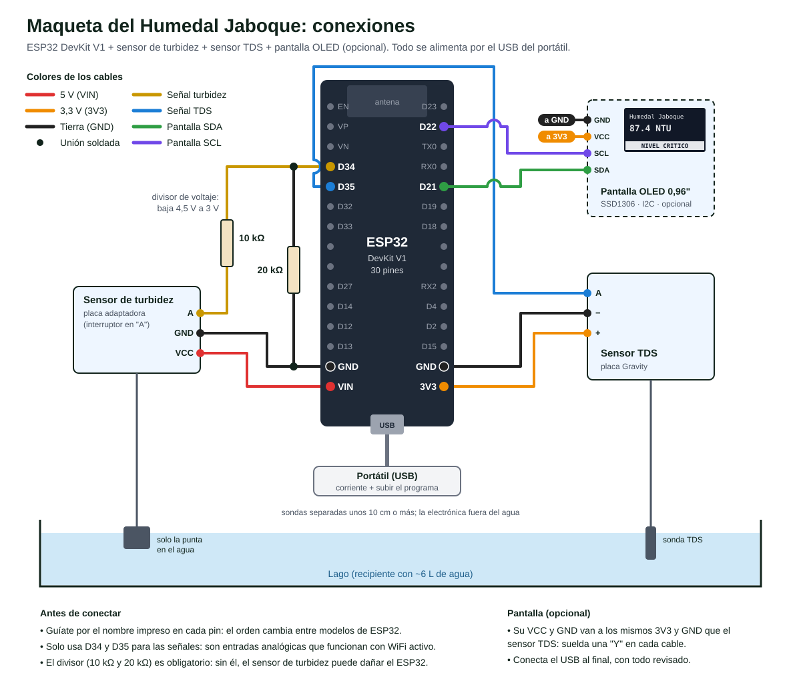

# Maqueta del Humedal Jaboque

Un modelo a escala del humedal con dos sensores sumergidos que miden qué tan contaminada está el agua. La maqueta envía una lectura cada 2 segundos a la web. Si el lago llega a un nivel crítico, el servidor manda una alerta a los celulares por Telegram.

## Cómo funciona

```
 [ LAGO: recipiente con agua ]          [ ESP32 ]  ── WiFi ──►  [ portátil: iot-server ] ──► web en vivo
   sonda de turbidez ───────── cable ──► GPIO 34                        │
   sonda TDS ───────────────── cable ──► GPIO 35                        └──► Telegram: 🚨 alerta al celular
```

1. Las dos sondas van sumergidas en el lago. El ESP32 queda afuera, en seco.
2. El ESP32 lee la **turbidez** (qué tan sucia se ve el agua) y los **sólidos disueltos** (TDS: sal, químicos, contaminación que no se ve).
3. El portátil recibe las lecturas, las muestra en la web y revisa los límites:
   - turbidez por encima de **50 NTU**, o
   - sólidos disueltos por encima de **500 ppm**, que es el límite de la EPA para agua de consumo.
4. Si un valor pasa su límite durante 6 segundos seguidos, llega al grupo de Telegram un mensaje como este:

   ```
   🚨 ALERTA · Humedal Jaboque
   Nivel crítico de contaminación
   ⚠️ Turbidez: 87 NTU (límite 50)
   Sólidos disueltos: 210 ppm (límite 500)
   16/11/26, 10:42 a. m.
   ```

   Si sigue crítico, llega un recordatorio cada 10 minutos. Cuando el agua se recupera, llega un "✅ volvió a la normalidad".

**Durante la presentación:** se echa una cucharada de tierra o café molido y se revuelve, y la turbidez se dispara. Luego se disuelve una cucharadita de sal, y el TDS sube por encima de 500 en unos 6 L de agua. En los dos casos, a los pocos segundos les llega la alerta a los celulares.

## Materiales

Precios aproximados en Bogotá (tiendas de la calle 19 o en línea), noviembre de 2026. No incluye herramientas: cautín, estaño, termoencogible y silicona.

| Cant. | Componente | Para qué | Precio aprox. (COP) |
|---|---|---|---|
| 1 | **ESP32 DevKit V1 de 30 pines** (15 por lado) con **ESP32-WROOM-32** (o 32D / 32E) | Lee los sensores, maneja la pantalla y envía por WiFi | 25.000 – 35.000 |
| 1 | Cable USB **de datos** (no solo de carga), del tipo que use la placa: micro-USB o USB-C | Corriente y subir el programa desde el portátil | 5.000 – 10.000 |
| 1 | Sensor de turbidez analógico (tipo DFRobot SEN0189), con su placa adaptadora | Qué tan sucia se ve el agua | 35.000 |
| 1 | Sensor TDS Gravity analógico (3,3–5 V), con su sonda y su placa | Sólidos disueltos | 35.000 |
| 1 | Pantalla OLED 0,96" **SSD1306 I2C** (128 × 64, **4 pines**) | Muestra las lecturas y el estado en la maqueta | 12.000 – 20.000 |
| 1 + 1 | Resistencias de **10 kΩ** y **20 kΩ** (o tres de 10 kΩ: una sola y dos en serie) | Divisor de voltaje del sensor de turbidez | 500 |
| 10 | Cables dupont **hembra-hembra** (6 para los sensores, 4 para la pantalla) | Unir todo al ESP32 | 4.000 |
| 1 | Recipiente plástico transparente (unos 6 L, ~30 × 20 × 12 cm) | El lago | 15.000 |
| | **Total** | | **≈ 130.000 – 155.000** |

Herramientas y consumibles que ya tienes: cautín, estaño, flux, termoencogible (o cinta aislante) y silicona o plastilina epóxica para fijar el sensor de turbidez.

**Al comprar la placa:** pide el **DevKit V1 con ESP32-WROOM-32**, de 30 pines, con el chip USB **CP2102** si lo hay (Windows lo reconoce sin instalar nada); con **CH340** también sirve, pero quizá haya que instalar su controlador. El de 38 pines (19 por lado) también sirve sin cambiar el firmware: solo cambia el orden de los pines. **No sirven sin cambios:** ESP32-CAM, ESP8266 / NodeMCU, ESP32-C3, S2 o S3, ni la **WROOM-32U** si no trae su antena externa.

**Al comprar la pantalla:** pide la versión **I2C de 4 pines** (GND, VCC, SCL, SDA), no la SPI de 7 pines. La LCD 1602 no sirve igual de bien: trabaja a 5 V y sus líneas de datos pueden dañar el ESP32 sin un convertidor de nivel.

La alimentación sale del USB del portátil. No hace falta protoboard: el divisor se suelda en el cable, y el 3V3 y el GND que comparten el sensor TDS y la pantalla se unen con una "Y" soldada (ver abajo).

## Conexiones



El diagrama también está en [`diagrama-conexiones.svg`](diagrama-conexiones.svg): ábrelo en el navegador para verlo grande o imprimirlo.

| Componente | Pin del componente | Va a |
|---|---|---|
| Sensor de turbidez | VCC | **VIN** (5 V) del ESP32 |
| | GND | GND |
| | Salida A (señal) | Resistencia de 10 kΩ → **GPIO 34**; de GPIO 34 sale la de 20 kΩ a GND |
| Sensor TDS | + | **3V3** |
| | − | GND (el otro pin GND del ESP32) |
| | A | **GPIO 35** |
| Pantalla OLED (opcional) | GND | GND (el mismo del TDS, con una "Y" soldada) |
| | VCC | **3V3** (el mismo del TDS, con una "Y" soldada) |
| | SCL | **GPIO 22** |
| | SDA | **GPIO 21** |

**Por qué el divisor:** el sensor de turbidez entrega hasta 4,5 V y los pines del ESP32 aguantan máximo 3,3 V. Las dos resistencias bajan el voltaje a dos tercios.

**Divisor soldado, sin protoboard:** corta un cable dupont hembra-hembra por la mitad.
- Suelda la resistencia de 10 kΩ en serie entre el cable que viene de la señal del sensor y el que va al GPIO 34.
- En la punta que va al GPIO 34, suelda un extremo de la de 20 kΩ. El otro extremo va a un cable que llega a GND.
- Cubre todo con termoencogible. Queda un arnés en "Y" de tres puntas: señal del sensor, GPIO 34 y GND.

El ESP32 DevKit V1 de 30 pines tiene un GND a cada lado: el sensor de turbidez usa el que está junto a VIN y el TDS el que está junto a 3V3. Si tu placa es de 38 pines, el orden cambia: guíate por el nombre impreso en cada pin.

**Cuidado con el agua:** solo las puntas de las sondas van dentro del agua. La cabeza del sensor de turbidez no es sumergible: fíjala al borde del recipiente con silicona o plastilina epóxica para que solo la parte inferior toque el agua. Separa las dos sondas unos 10 cm. El ESP32 y las placas de los sensores van fuera del recipiente.

## Programar el ESP32

1. Instala [Arduino IDE 2](https://www.arduino.cc/en/software).
2. En *Archivo → Preferencias → URLs adicionales de gestor de placas*, agrega
   `https://espressif.github.io/arduino-esp32/package_esp32_index.json`.
   Luego, en *Herramientas → Placa → Gestor de placas*, instala **esp32** de Espressif.
   En *Herramientas → Gestionar librerías*, instala **Adafruit SSD1306** (acepta instalar también **Adafruit GFX Library**). Hacen falta para compilar, aunque no conectes la pantalla.
3. En la carpeta `firmware/maqueta_jaboque/`, copia `secretos.ejemplo.h` como **`secretos.h`** y llénalo:
   - `WIFI_NOMBRE` y `WIFI_CLAVE`: la red WiFi a la que también está conectado el portátil.
   - `SERVIDOR`: la dirección que imprime `npm start` en la línea "ESP32 (misma WiFi)".

   `secretos.h` no se sube a GitHub (está en `.gitignore`), así tu clave del WiFi no queda publicada. Luego abre `maqueta_jaboque.ino`: el Arduino IDE muestra `secretos.h` en una pestaña.
4. Selecciona la placa **ESP32 Dev Module** y pulsa **Verificar** (✓): compila sin necesidad de tener el ESP32 conectado, así detectas cualquier problema antes.
5. Conecta el ESP32, elige el puerto COM y pulsa **Subir** (→). Si se queda en "Connecting…", mantén presionado el botón **BOOT** de la placa hasta que empiece a subir.
6. Abre el *Monitor serie* a 115200 baudios. Debes ver "Pantalla OLED encontrada" (o "Sin pantalla OLED", si no la conectaste) y luego una línea JSON cada 2 segundos.

**La pantalla muestra** la turbidez, los sólidos disueltos y una franja de estado: "Agua en buen estado", **"NIVEL CRITICO"** (invertida, exactamente cuando la web marca crítico y sale el Telegram), "Sin WiFi" o "Sin servidor". Si no muestra nada, revisa SDA/SCL; si tu pantalla usa la dirección 0x3D, cámbiala en `DIRECCION_OLED`.

> El ESP32 solo se conecta a redes de **2,4 GHz**. Las redes de las universidades con usuario y contraseña (WPA2-Enterprise) no sirven. Usa la zona WiFi de un celular, y que **tenga datos**: el portátil necesita internet para mandar las alertas a Telegram.

## Configurar las alertas de Telegram (10 minutos, una sola vez)

1. En Telegram, busca **@BotFather**, escribe `/newbot` y sigue los pasos. Al final te da un **token**, algo como `7412345678:AAH...`.
2. En `iot-server/`, copia `.env.ejemplo` como `.env` y pega el token en `TELEGRAM_TOKEN`.
3. Crea un **grupo** en Telegram con la profesora, el equipo y el bot. Escribe cualquier mensaje en el grupo, por ejemplo "hola".
4. Corre `npm run telegram` en `iot-server/`. Te muestra el número del grupo, que empieza con `-`. Pégalo en `TELEGRAM_CHAT_ID` dentro de `.env`.
5. Corre `npm run telegram` otra vez. Debe llegar un mensaje de prueba al grupo.

Los límites y cada cuánto se repite el aviso se cambian en el mismo `.env`. El archivo `.env` no se sube a GitHub porque el token es secreto.

Para probar sin la maqueta, corre `npm run demo` desde la raíz del proyecto. Solas, las lecturas simuladas se mueven un poco pero nunca pasan el límite, así que no le escriben al grupo sin que nadie lo pida. En la pantalla "Maqueta en vivo", pulsa **Echar tierra** o **Echar sal**: a los 6 segundos llega la alerta marcada "(simulación)". **Cambiar el agua** limpia el lago y llega el "✅ volvió a la normalidad".

> La página pública (Vercel) corre una demostración solo en el navegador: muestra el nivel crítico pero **no** manda mensajes a Telegram. Las alertas siempre salen del servidor del portátil, con `npm run demo` o con la maqueta real.

## Calibración (10 minutos)

**Turbidez.** Sumerge el sensor en agua limpia de la llave. Si marca más de 5 NTU, sube `AJUSTE_TURBIDEZ` de 0,05 en 0,05 hasta que marque cerca de 0. Este sensor sirve para mostrar cambios relativos, no para medir como un laboratorio. Vale la pena decirlo en la sustentación.

**TDS.** El agua de la llave de Bogotá debe dar entre 30 y 120 ppm. Al disolver una cucharadita de sal, el valor tiene que subir de forma clara. Si pasa de 500 con muy poca sal o no llega nunca, ajusta `UMBRAL_TDS` en `.env`.

## Antes de la presentación

- [ ] El portátil y el ESP32 están en la misma red: la zona WiFi del celular, con datos.
- [ ] En el portátil: `cd iot-server` y `npm start`. Anota la IP y revisa que diga "Alertas por Telegram activas".
- [ ] La IP del firmware coincide. Si cambió, actualízala y vuelve a subir el programa.
- [ ] Abre la web **en el mismo portátil, en Chrome**, y, en la pantalla "Maqueta en vivo", busca "Maqueta conectada" con el punto verde.
      Chrome puede pedir permiso para "acceder a dispositivos de la red local": acéptalo.
- [ ] Los celulares que van a recibir la alerta están en el grupo y tienen las notificaciones activas.
- [ ] Si algo falla, la web pasa sola al modo demostración y sigue funcionando.
      `npm run demo` también manda alertas a Telegram: se disparan con los botones Echar tierra y Echar sal.
